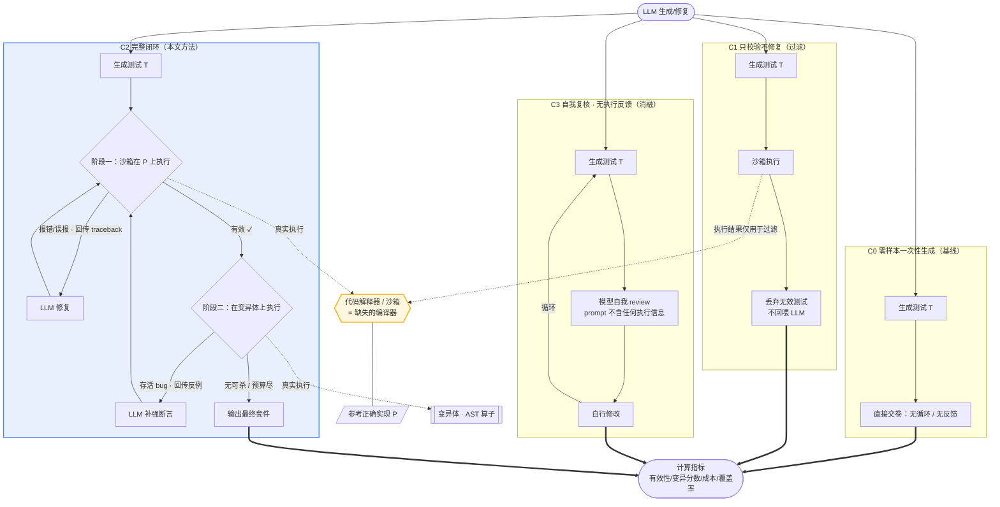

# 实验设计：闭环（生成-校验-修复）LLM 测试用例生成

> 研究主题：LLM 在软件缺陷检测与修复中的应用，聚焦点为 **LLM 生成测试用例**。
> 核心命题：**把代码解释器当作"缺失的编译器"**，将 *生成 → 校验 → 修复* 融合为一个闭环。
> 关键约束：每一次往返（round trip）都消耗算力；上下文窗口刚扩展到 128k，闭环的 token 累积会成为瓶颈。

---

## 1. 研究问题与假设

### 1.1 研究问题（RQ）

- **RQ1（有效性增益）**：相比零样本一次性生成，闭环（引入解释器执行反馈 + 修复）能在多大程度上提升生成测试的**有效性**（可编译 / 可执行 / 在正确代码上不误报）？
- **RQ2（缺陷检出增益）**：闭环——尤其是"以变异体为反例"的充分性修复阶段——能否提升测试套件的**缺陷检出能力（变异分数）**？增益在多少轮之后饱和？
- **RQ3（成本 / 窗口压力）**：随闭环轮次增加，**往返次数、累计 token、峰值输入 token** 如何增长？"质量↔成本"的帕累托前沿长什么样？128k 窗口在多深的轮次变成硬约束？
- **RQ4（模型差异）**：上述效应在 **GLM / 千问(Qwen) / DeepSeek** 三个模型上有何差异？谁的初始有效性最高、谁的修复收敛最快、谁最省 token？

### 1.2 可检验假设

- **H1**：闭环显著提升有效性（可执行率、零误报率）；对**有效性**的提升远大于对**变异分数**的提升（因为解释器只能廉价地判定"跑不跑得起 / 在正确代码上炸不炸"，但"够不够严格到抓 bug"是另一个更难的问题）。
- **H2**：质量随轮次呈**边际递减**（约 2–3 轮后基本饱和），而 token 近似**线性累积**——因此存在一个"甜点轮次 R\*"，超过它后每单位质量增益的成本急剧上升。
- **H3**：去掉解释器反馈的"自我复核"条件（C3）显著劣于带解释器的条件（C2），从而**隔离并证明"缺失的编译器"这一组件本身的价值**。
- **H4**：三个模型在"初始有效性"和"修复收敛速度"上分层明显；纯推理模型（如 DeepSeek-R1 类）在修复阶段更稳但更贵。

---

## 2. 变量设计

### 2.1 自变量（Independent Variables）

| 变量 | 取值 | 说明 |
|---|---|---|
| **模型** | GLM-4.5、Qwen3-Coder-Plus、DeepSeek-V3(`deepseek-chat`) | 均可配置；见 §6 模型接入表。可选加测 `deepseek-reasoner` 作为推理型对照。 |
| **条件（Treatment）** | C0 / C1 / C2 / C3 | 见 §3。这是实验的核心操纵。 |
| **最大轮次 R** | {1, 2, 3, 5} | 用于绘制"质量 vs 轮次"学习曲线并定位 R\*。 |
| **温度 / 采样** | 主实验 T=0（贪心，可复现）；补充 T=0.2 × N 次重复 | 主结果用确定性；重复实验用于估计方差。 |
| **数据集** | HumanEval、MBPP | 各自抽样或全量；见 §5。 |

### 2.2 因变量（Dependent Variables）—— 四个指标族，全部测量

#### A. 有效性（Validity）—— 直接体现"解释器即编译器"
- **A1 语法正确率** = 可被 `ast.parse` 的测试数 / 生成测试总数。
- **A2 可执行率** = 在沙箱内运行至结束（无 import/收集错误）的测试数 / 总数。
- **A3 零误报率 / APR（Acceptable Pass Rate）** = 在**参考正确实现**上全部通过、且至少能执行一个用例的套件比例。衡量"不会把正确代码判成错"。
- **收敛指标**：`rounds_to_valid`（首次达到 A2∧A3 全绿所需轮次），未达标记为截尾。

#### B. 缺陷检出 / 变异分数（Mutation Score）—— 贴合"缺陷检测"主题
- **变异分数 MS** = 被测试套件杀死的变异体数 / 有效（非等价）变异体总数。
  \[ MS = \frac{\#\{\text{killed mutants}\}}{\#\{\text{non-equivalent mutants}\}} \]
- **缺陷检出率（BDR）**：针对"植入式 buggy 版本"（§5.3）的检出比例，作为变异分数的交叉验证。
- **反例利用**：修复阶段中，"喂进变异体反例后新增杀死的变异体数 / 喂入的存活变异体数"，衡量闭环把反例转化为质量的能力。

#### C. 成本（Cost）—— 正面回应 round-trip 与 128k 瓶颈
- **C1 往返次数** = 每个被测程序触发的 LLM 调用次数。
- **C2 累计 token** = Σ(prompt + completion)，按模型返回的 `usage` 精确统计。
- **C3 峰值输入 token / 窗口占用率** = 单轮最大 prompt token / 128k；统计**撞窗比例**（占用率 > 90% 的轮次占比）。
- **C4 墙钟时延** = 每个实例端到端耗时。
- **C5 归一化成本** = 累计 token / (ΔMS + ε)，即"每提升一个百分点变异分数所需 token"，以及"每获得一套有效套件所需 token"。

#### D. 覆盖率（Coverage）—— 经典指标，用于与 B 做对照分析
- **D1 行覆盖率**、**D2 分支覆盖率**：`pytest-cov` 统计生成套件对参考实现的覆盖。
- 用途：检验"高覆盖 ≠ 高缺陷检出"这一已知陷阱在本设置下是否成立（覆盖与 MS 的相关性分析）。

### 2.3 控制变量（Constants，保证可比性）
- 提示词模板对所有模型/条件保持一致（§4）。
- 沙箱：每测试用例硬超时 5s；禁用网络与文件写；内存上限；同一 CPU 配额。
- 变异体集合、参考实现对每个程序固定（同一随机种子）。
- 执行日志回传格式统一，且做**尾部截断**（见 §7 窗口对策）。

---

## 3. 实验条件（核心操纵）

| 条件 | 名称 | 是否用解释器 | 是否修复 | 目的 |
|---|---|---|---|---|
| **C0** | Zero-shot 基线 | 否 | 否 | 一次性生成，直接测 A/B/C/D。所有对比的参照系。 |
| **C1** | 仅校验循环 | 是 | 否（只做丢弃/去噪） | 只跑、把无效测试丢掉，不再生成。分离"过滤"的贡献。 |
| **C2** | **完整闭环（本文方法）** | 是 | 是 | 生成→执行校验→按 traceback 修复；有效后再进入**变异引导的充分性修复**。 |
| **C3** | 自我复核（消融） | **否** | 是 | 让模型"自己 review 代码"来修复，**不给执行反馈**。用于隔离"缺失的编译器"组件的净贡献（验证 H3）。 |

**C2 的两阶段设计**（本实验的方法学亮点）：

```
阶段一 · 有效性闭环（Validity loop）
  repeat until valid 或 rounds==R:
     T = LLM.generate / repair(prompt, last_traceback)
     在参考正确实现 P 上执行 T
     if 出现 语法/运行时错误: 回传 traceback → 修复
     elif T 在 P 上 FAIL（P 正确 ⇒ 断言过强/oracle bug）: 回传失败断言 → 修复或丢弃
     else: valid ✓ 进入阶段二

阶段二 · 变异引导的充分性修复（Adequacy loop）
  repeat until 预算耗尽 或 无新变异体可杀:
     在存活变异体集合上执行 valid 的 T
     取若干"存活(mutant 未被杀死)"作为反例喂回 LLM
     LLM 生成/强化断言以杀死这些反例
     回到阶段一校验新 T 仍对 P 不误报（防止为杀 bug 而破坏有效性）
```

> 关键点：阶段二体现"解释器作为编译器的第二重身份"——变异测试执行就是给"测试够不够严"提供可计算的反馈；同时每次修复都要回到阶段一复检，保证有效性不回退。

### 3.1 四条件数据流对比图

> 看图重点：① 是否存在"回到 LLM 的反馈箭头"；② 反馈里**是否携带解释器的真实执行结果**。这两处差异正是 C0–C3 的全部区别。



**四句话读懂差异：**
- **C0**：生成即终态，没有任何回路——参照系。
- **C1**：有"执行"但反馈只用来**过滤**，不回喂模型，LLM 不被再次调用。
- **C3**：有"回到 LLM 的修复循环"，但回路里**不含执行信息**（模型自己闷头改）。
- **C2**：既有回路、回路里又**携带解释器真实反馈**，且额外用变异体做充分性修复——唯一同时具备"修复循环 + 执行反馈"两个零件的条件。C2 vs C3 的差 = "执行反馈（缺失的编译器）"的净贡献；C2 vs C1 的差 = "让模型改"的净贡献。

---

## 4. 提示词与输入契约

- **生成 prompt**：函数签名 + docstring + 参考实现 P + 输出格式约束（pytest 风格、每个用例一个函数、含明确断言）。要求返回纯代码块。
- **有效性修复 prompt**：原测试 + **精简 traceback**（截断到最近 N 帧 + 错误类型与消息）+ 指令"保持对正确实现的通过性，仅修复错误"。
- **充分性修复 prompt**：通过校验的测试 + 一个存活变异体（标注"这是正确代码的一个错误变体，你的测试没抓到"）+ 指令"补强断言以区分它，同时不得在 P 上失败"。
- **C3 自我复核 prompt**：仅原测试 + 指令"审查可能的语法/断言问题并修正"，**不含任何执行信息**。

---

## 5. 数据集、变异体与缺陷来源

### 5.1 被测程序（Programs under Test）
- **HumanEval**（164）与 **MBPP**（取 `mbpp` 前 250/全量，可配置）。每题提供：函数签名 + 参考实现 + **官方测试用例**。
- 官方测试用例的两大用途：(a) 验证变异体非等价；(b) 作为覆盖率/MS 的对照基线（"人类写的测试"）。

### 5.2 变异体来源（Python、AST 级、确定性）
内置一组经典 AST 变异算子，保证可复现（不依赖外部 LLM）：
- 关系比较符（`==→!=`, `<→<=`, `>→>=` …）
- 算术符（`+↔-`, `*↔/`）
- 布尔/条件（`and↔or`, 取反删除）
- 边界常量（`x → x±1`）
- 返回值变异（`return v → return None/[]/0`）
- （未来对照）接入 `mutmut` 生成更全变异体做敏感性分析——**本期不启用**（见 §11 决策 3）。

### 5.3 等价变异体过滤 & 缺陷集
- 一个变异体仅当**能被官方测试用例杀死**才被保留（即它确实改变了被规约的行为）——用它过滤等价/无意义变异体。
- 由此得到每程序一个"有效变异体集"，作为阶段二的反例池与 MS 的分母。

### 5.4 数据泄漏威胁
- HumanEval/MBPP 大概率已进入三家模型的训练语料。缓解：以**变异分数/反例利用**这类"需要针对新变异体推理"的指标为主结论，降低纯记忆的影响；并在报告中明确此为构念威胁（§7）。

---

## 6. 模型接入（统一走阿里百炼 · OpenAI 兼容）

**决策：三个模型均通过阿里百炼平台（Model Studio / DashScope）的 OpenAI 兼容接口调用**，因此全局只维护**一个** `base_url` + **一个** `api_key`（Token Plan），跨模型对比时**只有 `model` 字段不同**——这天然满足"控制变量"要求，也免去多套密钥/端点的维护。

| 模型 | model id（以你百炼控制台实际可用 id 为准） | 备注 |
|---|---|---|
| GLM（智谱） | `glm-4.5`（或百炼上架的对应 GLM id） | 三方托管 |
| Qwen（千问） | `qwen3-coder-plus` / `qwen-plus` | 百炼原生 |
| DeepSeek | `deepseek-v3` | 推理型对照可选 `deepseek-r1` |

- 统一 `base_url = https://dashscope.aliyuncs.com/compatible-mode/v1`；客户端用同一 OpenAI SDK，仅路由 `model`。
- **model id 需在百炼控制台核对**：三方模型的上架 id 可能与官方命名不同；实现时把 id 放进 `config.py` 便于你一键替换。
- 密钥经环境变量注入（如 `DASHSCOPE_API_KEY`），绝不写入代码/仓库。
- 记录每次调用返回的 `usage.{prompt_tokens, completion_tokens}` 作为成本真值。
- 不同模型的**上下文窗口上限可能不同**（64k/128k/256k…），运行时按 model id 记录各自上限，用于 §7 的窗口占用率计算。

---

## 7. 成本与窗口对策（针对 128k / round-trip 瓶颈）

- **traceback 尾部截断**：只回传最近 K 帧 + 错误类型/消息，单条日志上限字数固定。
- **历史压缩**：不逐字保留所有轮次，只对"当前测试版本 + 最近一次失败信息"负责；必要时用一句话摘要前几轮。
- **存活变异体采样**：阶段二每轮最多喂 m 个反例，避免把整个变异集塞进上下文。
- **撞窗即止**：单轮 prompt 占用率 > 90% 时记录一次"窗口截断事件"，作为 RQ3 的证据点。
- 全部轮次、token、截断事件写入结构化日志（JSONL），供复现与成本曲线绘制。

### 7.1 关于"是否要修改 / 控制上下文窗口大小"

- **窗口上限由模型/API 决定，我们无法也不需要"改大它"**——我们能控制的只是**每轮往上下文里塞多少**。函数级 HumanEval/MBPP 单轮输入（函数 + docstring + 当前测试版本 + 一条截断后的 traceback）通常 < 2k token，**128k 在本设置下几乎不会被触发**，除非盲目累积全部历史或回灌海量执行日志。
- **窗口会影响结果吗？会，但要区分两种影响：**
  1. **成本影响（会）**：把更多历史塞进上下文 → prompt token 涨 → 更贵更慢（正是 round-trip 命题）。对策即上面的截断/压缩。
  2. **质量影响（存在但反向）**：长上下文有"lost in the middle"效应，塞太多反而**降低**模型表现。故"窗口大"不等于"塞得多就好"，精简上下文通常反而提升生成/修复质量。
- **本实验的处理**：默认把窗口占用率作为**被测量的成本因变量**（§2 C3），而非自变量；若未来想主动研究窗口效应，再加一个**上下文预算自变量**（人为设 8k / 32k / 128k 三档）做敏感性分析——这属于扩展实验，当前不启用。
- **结论**：现阶段**不改窗口**，只做"上下文预算管理 + 占用率记录"。只有当扩展到类级/长文件或加入 mutmut 大日志时，128k 才可能成为真实瓶颈。

---

## 8. 实验协议与统计分析

- **重复**：补充实验 T=0.2，每条件×每程序重复 N=3 次，报告均值 ± 标准差。
- **顺序随机化**：程序与条件执行顺序随机，抵消 API 侧时间相关波动。
- **配对显著性检验**：
  - 二元指标（有效/无效）→ **McNemar 检验**（C0 vs C2 同程序配对）。
  - 连续指标（MS、覆盖率、token）→ **Wilcoxon 符号秩检验** + 效应量（如 Cliff's delta / A12）。
- **学习曲线**：以轮次为横轴绘制 MS / 有效性 / 累计 token，标注 R\*。
- **帕累托前沿**：以 (累计 token, MS) 作图，标出各模型各条件的支配关系。
- **相关性**：Spearman(覆盖率, MS)，验证"高覆盖 ≠ 高检出"。
- 多重比较用 Holm–Bonferroni 校正。

---

## 9. 有效性威胁（Threats to Validity）

- **构念威胁**：数据泄漏（§5.4）；变异分数依赖变异体质量（用官方测试过滤缓解；mutmut 对照列为未来工作）。
- **内部威胁**：API 非确定性（用 T=0 主实验 + N 次重复）；沙箱偶发超时（固定超时并记录，做敏感性分析）；不同模型 max-token/计价差异（统一预算上限并如实报告）。
- **外部威胁**：仅 Python、仅函数级（HumanEval/MBPP）；结论对类级/Java 外推需谨慎（未来工作）。
- **结论威胁**：样本量与效应量并报，避免仅凭均值差下结论。

---

## 10. 后续代码框架（设计定稿后的实现蓝图）

> 本节仅列模块边界，作为下一步实现的接口契约；确认设计后我再编码。

```
src/
  config.py          # 模型 base_url/key/model 表、预算与超时、窗口上限
  clients/           # OpenAI 兼容客户端封装（统一接口，按 model id 路由）+ Mock 客户端
  dataset/           # HumanEval / MBPP 加载器；参考实现与官方测试提取
  mutation/          # AST 变异算子 + 等价体过滤（官方测试杀死的才留）
  sandbox/           # 隔离执行 pytest，捕获 parse/run/pass/fail + 耗时 + 覆盖
  prompts/           # 生成 / 有效性修复 / 充分性修复 / 自我复核 模板
  loop/              # C0–C3 条件控制器；实现 §3 两阶段闭环
  metrics/           # validity / mutation score / cost / coverage 计算
  runner.py          # 实验编排：条件×模型×轮次×重复，写 JSONL
  analyze.py         # 读 JSONL，产出表格、显著性检验、学习曲线、帕累托图
```

- 先以 **Mock 客户端**打通端到端流水线（不消耗 API 额度），再无缝切换到真实云端密钥。
- 结果落 `results/*.jsonl` + 汇总 `summary.csv`；图落 `figures/`。

---

## 11. 已确认的实验决策（本次拍板）

1. **规模**：✅ 先**小规模**跑通（HumanEval / MBPP 各约 30 题），验证流水线与统计脚本后再放大。
2. **模型接入**：✅ **统一走阿里百炼（DashScope）OpenAI 兼容接口**，单一 base_url + 单一 Token Plan api_key，仅 `model` 不同（见 §6）。
3. **变异体引擎**：✅ 本期**仅用内置 AST 变异算子**（可控、可复现、省钱）；`mutmut` 列为未来敏感性对照，不在本期启用。
4. **C3 消融**：✅ **保留**，作为隔离"执行反馈（缺失的编译器）"净贡献的关键对照（论文亮点，验证 H3）。

### 11.1 仍需在实现阶段确认的细节
- 三者在百炼控制台的**准确 model id**（填入 `config.py`，可随时替换）。
- 是否加测推理型对照（`deepseek-r1` 等）——会显著抬高成本，建议二期再加。
- 预算上限：单实例最大往返次数与最大 token 花费的硬阈值（用于防失控）。

---

## 12. 结果解读指南（`figures/` 三张图怎么读）

> 本节数字均来自真机主实验：HumanEval 前 50 题 × 3 模型 × C0~C3，共 600 试次（`results/run_20261011_002236.jsonl`）。图由 `src/analyze.py` 自动生成，每次跑完刷新。

> 先约定三个"黑话"：**有效性(valid)** = 测试能不能跑、且在正确代码上不误报（=1 表示能用）；**变异分数(MS)** = 测试能不能抓出故意埋的小 bug（=1.0 全抓到，越低越迟钝）；**token 成本** = 跑一道题总共花了多少 token（≈花了多少算力/钱）。

### 12.1 `aggregate_bars.png` —— 三种“成绩单”并排比
三块子图，横轴都是 C0/C1/C2/C3，每块内不同颜色柱=不同模型。
- **左 · Validity rate（越高越好）**：C2 全线最高（deepseek 0.70→1.00）；**C3 在 deepseek/glm 上断崖跌至 0.60/0.46，比什么都不做的 C0 还低**——无执行锚点的自我复核会把本来正确的套件“改坏”。qwen 各条件 ≥0.94，天花板效应。
- **中 · Mutation score（越高越好）**：C0→C2 普遍小幅爬升（deepseek +0.114，Wilcoxon p=0.025 显著）；C3 不比 C2 高——多花 2~3 倍成本买不到检出力。
- **右 · Token cost（越低越好）**：C0/C1 几乎一样便宜（都只调用 1 次），C2 中等，**C3 全线最贵**（glm/qwen 达 11~14k）。→ 印证 H1/H2/H3。

### 12.2 `pareto.png` —— “花多少钱 vs 办多好事”的取舍图（按模型分面）
每个模型一个子图（小倍数），横轴=token 成本（越左越省），纵轴=MS（越上越好）；半透明小点=单次试次，**黑边大星标=该条件均值**（旁标 C0~C3）。**只绘制 valid 套件**（无效套件的 MS 是“断言过强”假象，剔除免误导）。看点在**左上角**：
- **glm 面板**最典型：C2 星标在 C0 右上方（多花 ~2.9k token 换 MS 提升）；C3 星标在 C2 右边几乎不涨——花钱买安心。
- **qwen 面板**：四星标挤在 MS≈0.77~0.79 一条横线上、成本却从 3k 拉到 15k——强模型上闭环/复核都买不到质量。
- 顶部贴 1.0 与底部贴 0 的两簇点分别对应“全杀”与“全漏”两个极端群体；用于定位成本↔质量帕累托前沿（RQ3）。

### 12.3 `coverage_vs_ms.png` —— “覆盖率高 ≠ 抓得住 bug”（分箱箱线图）
横轴=覆盖率分箱（<70 / 70~90 / 90~<100 / =100，标样本量），纵轴=MS；箱体=四分位距，黑线=中位数，蓝点=抖动散点（看真实分布），标题附 **Spearman ρ**。主实验实测：474/493 个样本都是 100% 覆盖，但这一箱内 **MS 从 0.00 一直散布到 1.00**（图中红字标注）——满覆盖对“能不能抓到 bug”给不出任何保证，ρ=-0.14 接近于零。→ 论证“为何必须看变异分数而非只看覆盖率”（指标族 B 的立论依据）。

---

## 13. 接真机操作手册（阿里百炼 · 逐步）

> 前提：你已有百炼 Token Plan，三个模型都能调。以下每步都可复制粘贴。

1. **拿 API Key**：登录百炼控制台 → "API-KEY 管理" → 复制你的 Key（形如 `sk-...`）。
2. **核对 model id**：在"模型广场"确认 GLM / Qwen / DeepSeek 三者的**实际可调用 id**（三方模型 id 可能不同于官方命名）。
3. **改 `config.py` 的 `MODEL_REGISTRY`**：把 `model_id` 换成第 2 步核对值；`window` 填各模型真实上下文上限；必要时调 `max_output_tokens`。
4. **建 `.env`**：把 `.env.example` 复制为 `.env`，填入 `DASHSCOPE_API_KEY=sk-你的密钥`（`.env` 已被 `.gitignore` 忽略，不会提交）。
5. **装数据依赖**（拉 HumanEval/MBPP 才需要；samples 离线不需）：`pip install ".[data]" -i https://pypi.tuna.tsinghua.edu.cn/simple`。
6. **连通性冒烟测试**（最小成本，1 题 × 1 条件）：
   ```powershell
   & ".venv\Scripts\python.exe" main.py --backend bailian --models glm --conditions C0 --source samples --limit 1
   ```
   能返回并看到 token 统计即接通；若报 `未检测到 DASHSCOPE_API_KEY` 说明 `.env` 未生效，若报 `model not found` 说明 model id 写错。
7. **小规模真实实验**（建议先 10 题）：
   ```powershell
   powershell -ExecutionPolicy Bypass -File .\run_all.ps1 -Backend bailian -Source humaneval -Limit 10
   ```
8. **逐步放大 / 上全量**：确认结果与花费合理后，把 `-Limit` 调大或去掉（见 §14 成本）。
9. **全程在控制台监控花费**，并可先用 `-Conditions C0,C2` 等子集省着跑。

---

## 14. 成本估算（接真机到底花多少钱）

> 关键：**只有 LLM 调用计费**；变异体构建、沙箱执行、覆盖率都是**本地跑、不花 API 钱**。所以成本 ≈ 试次数 × 每试次 token × 单价。

**单试次 token 量级估算**（函数级、含 docstring+参考实现，修复轮逐轮回喂当前测试+traceback）：
- C0/C1：1 次调用 ≈ 1.5–2.5k tokens；
- C3：≤R 次 ≈ 3–5k tokens；
- C2：1 生成 + 若干修复 + 若干充分性补强 ≈ 4–8 次 ≈ **6–15k tokens**（最贵）。

**全量规模**（实测：HumanEval 164 + MBPP(full/test) **500** = **664 题** × 4 条件 × 3 模型 = **7968 试次**，主实验 T=0、无重复）：
- 每试次均值按 ~5k tokens 计 → **总 token ≈ 3000 万–5000 万（30–50M）**。
- 若再叠加 §8 的 N=3 重复（T=0.2）→ 约 **×3 ≈ 90–150M tokens**。

**折成钱**（百炼按 token 计价，不同模型档差很大，以下为量级参考，务必以控制台实时价为准）：
- 中档模型（qwen-plus / deepseek-v3 / glm 通用档，约 ¥1–4/百万 input、¥4–12/百万 output）：
  - 全量主实验（30–50M）≈ **¥150–700**；含重复 ≈ **¥500–2500**。
- 若用高档模型（qwen-max / glm 高参数档，可达 ¥20–60/百万级）：全量可能 **上千至数千元**，含重复轻松破 **¥3000–8000**。
- **小规模（先跑 10–30 题）**通常仅 **¥5–40**，是验证流水线性价比最高的方式。

**省米手段（已内置或可选）：**
- 先 samples/10 题跑通再放大（决策 1）；
- R 设 2–3 即可，学习曲线显示收益边际递减；
- 主实验只跑 T=0 确定性单次，重复留给子集；
- C0/C1 无循环、极便宜，可多模型全上；真金白银主要在 C2；
- 变异体/覆盖率本地完成，**零 API 成本**（提速改造已落地）。

### 14.1 降本改造（已落地）
- **限定用例数**：生成/修复系统提示要求“用例总数 6~10 个、优先高区分度边界”（qwen/glm 原本单题写 20+ 用例，是最大 token 来源）。
- **阶段二轮次收紧**：新增 `Budget.max_adequacy_rounds`（默认 2），充分性修复不再跟 `max_rounds` 走。
- **任务级并行**：`Settings.parallel` / `--parallel N`，按 (model, problem) 并发（沙箱临时目录唯一、线程安全；API 为网络 IO，线程近线性加速）。

### 14.2 跑 30 题需要多久？（基于真机实测推算）
实测基准：qwen 串行 8 试次（含重 C2/C3）= **1769s**，≈ **3.7 分/试次**（C0/C1 快、C2/C3 慢）。
- **规模**：30 题 × 4 条件 × 3 模型 = **360 试次**。
- **串行**：≈ **15–22 小时**（降本后单试次变快，取低值）。
- **去掉 C3（主实验只 C0/C1/C2）**：270 试次 → 串行 ≈ **11–16 小时**。
- **并行 `--parallel 8`**：墙钟≈除以并发数（受百炼并发限流封顶）→ **≈ 2–3 小时**；`--parallel 16` → **≈ 1–1.5 小时**。
- **钱**：30 题属小规模，降本后总 token ≈ **2–3M**，中档模型约 **¥10–40**——**时间是主要矛盾，不是钱**。
- **推荐配置**：`--parallel 8`、主实验 `-Conditions C0,C1,C2`、C3 另开小样本单独跑。
